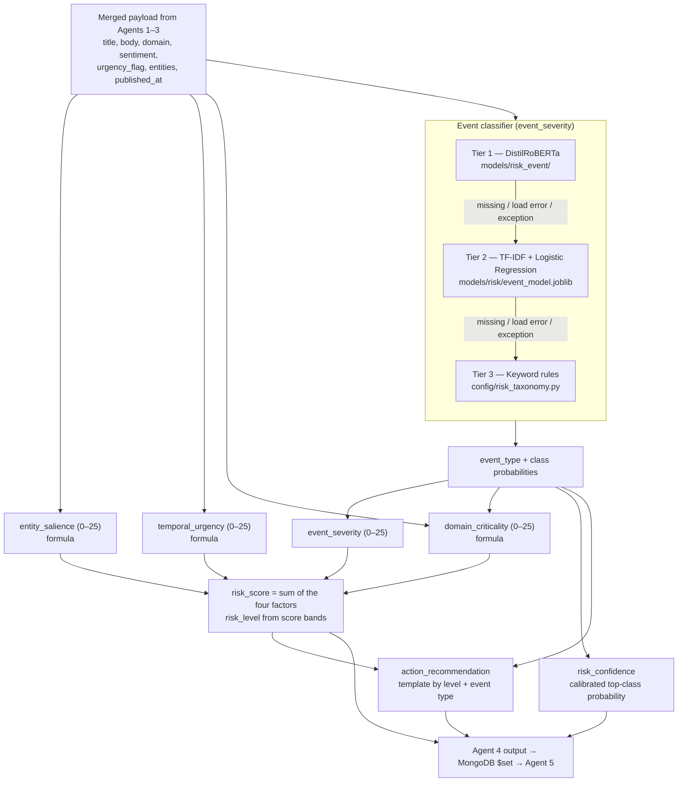
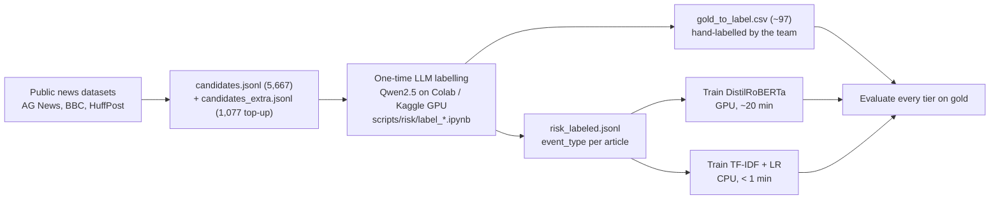

# Agent 4 — Offline Risk Scorer: Architecture

> **Status:** implemented. `RISK_BACKEND=model` (the default) scores offline with this design; `auto` / `groq` / `ollama` keep the older LLM scorer.
> The offline scorer makes **no LLM calls at runtime**.
> The [Implementation status](#10-implementation-status) section lists the files and what is still open.

---

## 1. Goal

For every in-scope article (sports, entertainment/movies), Agent 4 outputs:

- a **risk score** from 0 to 100
- a **risk level**: `MONITOR` (0–39), `ALERT` (40–69) or `ESCALATE` (70–100)
- a **confidence** from 0 to 1
- a breakdown into **four factors**, each scored 0–25
- a one-sentence **action recommendation**

The output fields and the MongoDB contract stay exactly as they are today, so Agents 5, the API and the
dashboard need no changes.

### Design principles

| Principle | How it is met |
|---|---|
| No LLM at runtime | A small fine-tuned classifier, plus formulas over Agent 1–3 outputs |
| Always produces a score | Three-tier fallback: DistilRoBERTa → TF-IDF + logistic regression → keyword rules |
| Explainable | Each factor has a visible reason: the event type, the matched evidence and the inputs used |
| Cheap | Runs on CPU in about 10–30 ms per article (DistilRoBERTa) or about 1 ms (fallbacks) |
| Traceable | `risk_model` records which tier produced each score |

---

## 2. High-level architecture



Only **one** of the four factors needs a learned model, which keeps the system small: event severity, meaning
"what kind of thing happened". The other three are deterministic formulas over signals that Agents 1–3 already
produce.

---

## 3. Event taxonomy

There are eight event types, and each maps to a typical `event_severity` value. This is the single source of
truth, shared by training and runtime, in `config/risk_taxonomy.py`.

| Event type | Severity (0–25) | Covers |
|---|---|---|
| `routine` | 2 | Results, previews, transfers, releases, trailers, box office, awards, reviews: nothing has gone wrong |
| `controversy` | 8 | Criticism, feuds, offensive remarks, fan backlash, scandals with no legal action or sanction yet |
| `injury` | 12 | Injury, illness or health scare; ruled out or sidelined |
| `legal` | 16 | Lawsuits, arrests, charges, police investigations, court rulings |
| `ban_suspension` | 17 | Bans, suspensions, fines or sanctions by a league, studio, censor board or government |
| `cancellation` | 18 | Matches, tournaments, shoots or releases cancelled, postponed, pulled or relocated |
| `integrity` | 21 | Doping, match-fixing, spot-fixing, illegal betting, bribery or corruption in sport |
| `death_tragedy` | 25 | Death, fatal accident, stampede, violence or disaster involving people in the story |

**Design decisions:**

- **One severity per event type.** The labelling LLM's per-article severity barely varied within a type
  (standard deviation 0.2–0.9 points), so a separate severity regressor would add nothing. The event type alone
  sets severity.
- **`doping` and `match_fixing` are merged into `integrity`.** The public news datasets had only 23
  match-fixing articles in total, which is too few to learn a separate class.
- **Taxonomy changes need a retrain.** If any type or severity changes, bump the prompt version, relabel and
  retrain all tiers.

---

## 4. The three-tier event classifier

### Tier 1 — DistilRoBERTa (main model)

| Item | Value |
|---|---|
| Base model | `distilroberta-base` (82M parameters) |
| Head | One linear classification head with 8 classes (event type) |
| Input | `"{title}. {body}"`, truncated to 256 tokens |
| Output | Softmax over the 8 types, after **temperature scaling** so the probabilities are calibrated |
| Location | `models/risk_event/` (`model.safetensors`, tokenizer, `label_config.json` with the taxonomy version) |
| CPU speed | About 10–30 ms per article; batched in the pipeline |
| `risk_model` value | `distilroberta:event-v2` |

**Why DistilRoBERTa:** it reads context, which keywords and bag-of-words models can't. For example, it can
tell "*killed it* at the box office" from "killed in a crash", or a film *about* doping from a doping case.
Agent 2 already runs a DistilRoBERTa model in this project (`agents/classifier_model.py`), so the stack and
loading code are proven here.

### Tier 2 — TF-IDF + logistic regression (fallback)

| Item | Value |
|---|---|
| Features | Word unigrams and bigrams, `min_df=2`, sublinear TF |
| Classifier | Logistic regression, `C=4`, `class_weight="balanced"` |
| Location | `models/risk/event_model.joblib` (pipeline plus training metadata) |
| Training | `python -m scripts.risk.train_event_model` (CPU, under 1 minute) |
| CPU speed | About 1 ms per article |
| `risk_model` value | `tfidf:event` |

It is used when the DistilRoBERTa folder is missing (for example on a fresh clone), fails to load (for
example a torch or transformers version mismatch) or throws at inference. It needs only scikit-learn, which
is already in `requirements.txt`.

### Tier 3 — Keyword rules (last resort)

Each event type has an ordered list of regex patterns, checked from most to least severe. The first match
wins, and no match means `routine`. It needs no model file, so Agent 4 **always** returns a score.

`risk_model` value: `rules:v1`.

### When a fallback is used

A lower tier is used **only when a higher tier cannot run**: missing files, a load error or an inference
exception. Low confidence does **not** trigger a fallback, because a weaker model being more confident
doesn't make it more accurate. Each fallback is logged once at startup and recorded per article in
`risk_model`, so the scores from different tiers can be told apart later.

---

## 5. The four factors

Each factor is an integer from 0 to 25, and the risk score is their sum.

### 5.1 `event_severity` — from the event classifier

```
event_type     = argmax(probabilities)
event_severity = EVENT_SEVERITY[event_type]
```

**Severity guard:** if a keyword rule matches a *more* severe type and the model gives that type at least
0.20 probability, use the more severe type. This trades a few false alarms for fewer missed serious events.
The keyword rules alone catch 86% of high-severity events, against 69% for TF-IDF.

### 5.2 `entity_salience` — from Agent 1

```
top            = entity with the highest salience
entity_salience = round(25 × (0.6 × top.salience + 0.4 × min(1, top.mention_count / 5)))
no entities    → 5
```

A story centred on one named person or club scores higher than one that mentions many people in passing.

### 5.3 `temporal_urgency` — from Agent 2 and the article date

```
temporal_urgency = 3
                 + 10 if urgency_flag
                 + round(8 × max(0, −sentiment))
                 + 4 if published ≤ 24 h ago, + 2 if ≤ 72 h
                 + 3 if urgent words ("breaking", "today", "tonight", "ruled out", "imminent")
clamped to 0–25
```

### 5.4 `domain_criticality` — domain base plus incident probability

```
base               = {sports: 12, entertainment_movies: 8, other: 5}[domain]
domain_criticality = base + round(8 × (1 − P(routine)))
clamped to 0–25
```

This follows the current LLM prompt, where sports and entertainment start low but rise when something has
gone wrong.

### 5.5 Worked examples

| Article | Severity | Salience | Urgency | Domain | **Score** | **Level** |
|---|---|---|---|---|---|---|
| Routine match preview | 2 | 10 | 3 | 12 | **27** | MONITOR |
| Star striker ruled out of the final with a knee injury | 12 | 18 | 23 | 18 | **71** | ESCALATE |
| Film release postponed by two weeks | 18 | 12 | 9 | 15 | **54** | ALERT |
| Player dies after collapsing on the pitch | 25 | 20 | 25 | 20 | **90** | ESCALATE |

> The weights above are starting values. Tune them on the gold set (section 7) so that the level bands match
> how an analyst would triage.

---

## 6. Confidence and recommendation

### Confidence

| Tier | `risk_confidence` |
|---|---|
| DistilRoBERTa | Top-class probability after temperature scaling |
| TF-IDF + logistic regression | Top-class probability × 0.9, reflecting its lower measured accuracy |
| Keyword rules | 0.5 when a rule matched, 0.4 when it defaulted to routine |

The labelling LLM's own confidence isn't used, because it was always 0.9–1.0 and carried no information.

### Action recommendation

This is a template keyed by risk level and event type, filled with the event evidence. For example:

- `ESCALATE` + `integrity`: "Escalate: possible integrity case (*tested positive*) involving {top entity}; verify with official sources now."
- `ALERT` + `injury`: "Track {top entity}'s injury (*ruled out*) for squad and fixture impact over the next 48 h."
- `MONITOR` + `routine`: "No action needed; keep in the routine feed."

---

## 7. Data and training pipeline



1. **Candidates.** In-scope articles from public datasets, plus a keyword-mined top-up for rare types
   (doping, cancellations, bans, legal) by `scripts/risk/build_topup.py`. The keywords only choose *which*
   articles get labelled; the LLM decides the label.
2. **Labelling (one-time and offline).** An LLM labels each article with `in_scope` and `event_type`. This is
   the only place an LLM is used, and it never runs in production.
3. **Gold set.** About 97 articles, stratified by event type with more for the rare high-stakes types, are
   **hand-labelled by people**. They are never used for training, only for the final accuracy numbers.
4. **Training.**
   - DistilRoBERTa: 3–4 epochs, learning rate 3e-5, batch 32, class-weighted cross-entropy, 10% validation
     split for early stopping and temperature scaling. Takes about 20 min on a T4.
   - TF-IDF + logistic regression: one command on CPU.
5. **Promotion rule.** DistilRoBERTa becomes Tier 1 only if it beats TF-IDF on **gold macro-F1**. Otherwise
   TF-IDF stays primary until there are more labels.

---

## 8. Evaluation

### Metrics

| Metric | Why |
|---|---|
| Macro-F1 over 8 event types (main metric) | Rare, high-stakes types count as much as `routine` |
| Accuracy | Overall sanity check |
| High-severity recall (legal and above) | Missing a serious event is worse than a false alarm |
| Severity MAE (0–25) | How far off the factor is, in points |
| Risk-level agreement on gold | Whether MONITOR, ALERT and ESCALATE match analyst judgement |
| Calibration (ECE) | Whether a confidence of 0.8 is right about 80% of the time |

### Current measured results

**On the hand-labelled gold set** (86 in-scope articles, never used in training). These are the numbers to report:

| Model | Accuracy | Macro-F1 | High-severity recall | Severity MAE |
|---|---|---|---|---|
| **DistilRoBERTa (main)** | **73.3%** | **0.677** | **92.7%** | 2.72 |
| TF-IDF + logistic regression (fallback) | 67.4% | 0.652 | 85.5% | 3.62 |
| Qwen2.5-7B, the labelling LLM, for reference | 73.3% | 0.698 | 96.4% | 2.28 |

DistilRoBERTa beats TF-IDF on gold macro-F1, so by the promotion rule it is the main model. It matches the
7B LLM that labelled its training data on accuracy, at about 1/100th of the compute and with no API.

**On the held-out validation split** (759 articles, LLM labels; doping fix applied):

| Model | Accuracy | Macro-F1 | High-severity recall |
|---|---|---|---|
| DistilRoBERTa | 87.4% | 0.807 | 97.2% |
| TF-IDF + logistic regression | 82.1% | 0.728 | 81.2% |

Calibration error after temperature scaling (T = 1.18): ECE 0.029, so a confidence of 0.8 is right about 80% of
the time. The keyword rules alone score 75.8% accuracy and macro-F1 0.56 on the v1 LLM labels.

**Doping label fix.** Qwen-7B labelled many clear doping articles as `controversy`, `legal` or `ban_suspension`.
Training relabels the 259 such rows that match unambiguous doping or fixing terms to `integrity`
(`INTEGRITY_FIX_RX` in `config/risk_taxonomy.py`).

---

## 9. Integration with the pipeline

### Configuration

| Setting | Values | Meaning |
|---|---|---|
| `RISK_BACKEND` | `model` (new) | Offline scorer, DistilRoBERTa → TF-IDF → rules, with no LLM calls |
| | `auto` / `groq` / `ollama` | Existing LLM backends, unchanged |
| `RISK_EVENT_MODEL_DIR` | default `models/risk_event` | Tier 1 weights |
| `RISK_TFIDF_MODEL_PATH` | default `models/risk/event_model.joblib` | Tier 2 model |

### Output contract (unchanged)

```json
{
  "risk_score": 71,
  "risk_level": "ESCALATE",
  "risk_confidence": 0.84,
  "risk_reasoning": {"event_severity": 12, "entity_salience": 18, "temporal_urgency": 23, "domain_criticality": 18},
  "action_recommendation": "Track Player X's injury (ruled out) for squad and fixture impact over the next 48 h.",
  "risk_model": "distilroberta:event-v2"
}
```

`storage/mongo_store.py:update_article_risk` already allows exactly these keys, so no storage changes are
needed.

Unlike the LLM backends, the offline scorer can always produce a score. Every article is therefore written to
MongoDB, and nothing is left pending.

---

## 10. Implementation status

| Component | File | Status |
|---|---|---|
| Candidate top-up | `scripts/risk/build_topup.py` | Done (1,077 extra candidates) |
| LLM labelling notebooks | `scripts/risk/label_kaggle.ipynb`, `label_colab.ipynb` | Done; v2 labels (5,347 rows) in `data/risk/`, v1 kept in `data/risk/v1/` |
| Event taxonomy + keyword rules | `config/risk_taxonomy.py` | Done |
| TF-IDF training script | `scripts/risk/train_event_model.py` | Done; trained on v2 labels |
| Gold set | `data/risk/gold_to_label.csv`, `data/risk/ANNOTATION_GUIDE.md` | Hand-labelled (scored on Kaggle) |
| DistilRoBERTa training notebook | `scripts/risk/train_event_distilroberta.ipynb` | Done; trained on Kaggle |
| Runtime scorer (tiers + formulas + templates) | `agents/risk_model.py` | Done |
| `RISK_BACKEND=model` in Agent 4 (now the default) | `agents/agent4_risk_scorer.py`, `config/settings.py` | Done |
| Setup check | `run_mapnai.py --check` | Done |
| Tests | `tests/test_agent4_model.py` | Done |

### Getting the models on a fresh clone

`models/` is not in git.
- **DistilRoBERTa:** unzip `mapnai_risk_event_model.zip` into `models/` so that `models/risk_event/config.json`
  exists, or retrain it with the notebook.
- **TF-IDF fallback:** rebuild it from the committed labels with `python -m scripts.risk.train_event_model`.
- **Without either:** Agent 4 still runs on the keyword rules.

### Still open

1. Tune the factor weights against analyst triage of real pipeline articles (the weights in section 5 are
   starting values).
2. `risk_event_type` is passed to Agent 5 but is not stored in MongoDB, because `update_article_risk` keeps only
   the existing keys.
