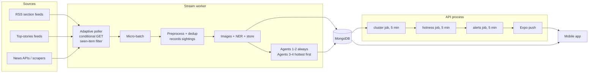

# MAPNAI — Continuous News Stream and Hit-News Detection

*Explanation for the project presentation and report. Every number, formula and threshold here is the one the
code uses (defaults; all are configurable). File paths point at the implementation.*

---

## 0. Summary

MAPNAI used to collect news in **batches**: every 30 minutes it downloaded every feed, re-processed every item
in it, and only then could the personalization engine cluster stories and raise alerts. A breaking story could
take up to **two hours** to reach a reader, and the system had no notion of a story being *hot*.

This module turns ingestion into a **continuous stream** and adds **hit-news detection**:

1. A long-running **stream worker** polls each source on its own adaptive schedule, skips anything already
   seen, and pushes new articles through the existing pipeline in small **micro-batches**.
2. Deduplication now **keeps the coverage signal**: a copy of a story from another outlet is still dropped, but it
   is recorded as a *sighting* on the original, so "how many outlets ran this" survives.
3. A **hotness score `H`** per story (event cluster) measures how fast and how widely a story is spreading, and
   assigns a tier: **breaking**, **trending** or **normal**.
4. **Hit news for the user** combines hotness with the reader's exposures (what they own, follow, depend on), and
   is delivered as a real **push notification** on the phone.

The result: publish → phone in roughly **10–15 minutes** for a breaking story, with *less* total computation than
the batch design, because work is done once per new article instead of once per poll.

---

## 1. Problem statement

| Problem in the batch design | Effect |
|---|---|
| All ~70 feeds polled every 30 min, regardless of how often each publishes | Fast feeds (cricket, football) are always up to 30 min stale; slow feeds (IMF, RBI) are polled 48× a day for nothing |
| Every poll re-processes all ~3,500 feed entries (≤ 50 per feed) | The same items are cleaned, language-detected and dedup-checked again every run, then thrown away |
| Duplicate check compares each entry against up to 100,000 stored fingerprints, one by one | Measured **63 ms per entry → ~220 s per run** once the database is full, and it keeps growing |
| Duplicates are silently dropped | The strongest "this is big" signal — 12 outlets publishing the same story — is lost before clustering sees it |
| Agents 1–4 run as a separate poller every 15 min; clustering hourly; alerts every 5 min; app polls every 5 min | Publish → reader can take **up to ~2 hours** |
| Materiality `m` measures *importance* (risk, size, first report, credibility) but not *speed* | Nothing distinguishes a story exploding right now from an important but slow one |
| Alerts are only stored server-side; the app polls them | No real-time delivery |
| Bluesky firehose posts (200 random posts per run) are stored as "articles" | Noise in the article store |

## 2. Objectives

1. Ingest new articles within minutes of publication, at a cost proportional to the number of **new** articles.
2. Detect stories that are a **hit in general** (breaking / trending) using only cheap, explainable signals.
3. Detect stories that are a **hit for a specific user** and notify them on their phone.
4. Keep everything auditable: every score is stored with its components, like materiality.
5. Leave the existing daily experience (digest, feed, recaps, Big today) unchanged, only fresher.

## 3. The three news streams

| Stream | Meaning | Where the reader sees it | Driven by |
|---|---|---|---|
| **Daily news** | The normal flow of stories | Home brief (must-know / for you / explore), Flash feed, daily and weekly recaps, Big today | Existing digest, feed and recap engine, now fed continuously |
| **Hit news — general** | A story blowing up for everyone right now | "Breaking" strip on Home, first cards in Flash, optional push | Hotness score `H` and its tier (`breaking`, `trending`) |
| **Hit news — for you** | A story that matters to *this* reader | Push notification + alert banner on Home + Notifications screen | Need = materiality × exposure (existing), plus "breaking in your world" |

Importance vs heat — two different questions:

- **Materiality `m`** (existing): *how much does this story matter?* (risk, cluster size, first report, credibility)
- **Hotness `H`** (new): *how fast and how widely is this story spreading right now?*

A story can be important but slow (a policy change reported once), or hot but minor (a viral clip). The system
keeps both scores and uses each where it fits.

---

## 4. Architecture

Two long-running processes share one MongoDB:

```
                    ┌───────────────────────── STREAM WORKER (stream_worker.py) ─────────────────────────┐
  RSS / top-story   │  Source scheduler ──► Poller (conditional GET, seen-item filter, 8 in parallel)     │
  feeds, news APIs, │        ▲ adaptive interval per source              │ new items only                   │
  scrapers          │        │                                            ▼                                  │
 ─────────────────► │  source_state (Mongo)                     Micro-batch buffer (flush every 2 min)       │
                    │                                                     │                                  │
                    │   Preprocess → images → NER/enrich → store (Mongo + FAISS + Neo4j)                     │
                    │   (resident models, banded SimHash dedup that records sightings)                       │
                    │                                                     │                                  │
                    │   Agents 1–2 on the new articles; Agents 3–4 (LLM) on a small budget, hottest first    │
                    │   Optional: Bluesky Jetstream social counter for trending stories                      │
                    └────────────────────────────────────────────────────┬───────────────────────────────────┘
                                                                         │  MongoDB (processed_articles,
                                                                         │  clusters, prominence, sightings …)
                    ┌────────────────────────── API PROCESS (run_api.py) ▼ ──────────────────────────────────┐
                    │  Scheduler (APScheduler):                                                              │
                    │    cluster  every 5 min  → event clusters + materiality m                              │
                    │    hotness  every 5 min  → H + tier per cluster (+1 min after cluster)                 │
                    │    alerts   every 5 min  → exposure / breaking-for-you / breaking-global alerts → push │
                    │    digests, recaps, τ, proposals … (unchanged)                                         │
                    │  REST /v1: digest, feed, top, breaking, alerts, push tokens, admin/sources …           │
                    └────────────────────────────────────────────────────┬───────────────────────────────────┘
                                                                         │ Expo push service + REST
                                                                         ▼
                                                           Mobile app (Expo / React Native)
```

Mermaid version (renders in GitHub / many slide tools):



Why two processes: the worker holds the NLP models in memory and does the heavy lifting; the API stays
responsive for the app. MongoDB is the hand-off between them (it already was the queue for Agents 1–4).

---

## 5. Components

### 5.1 Source registry and roles (`config/sources.py`)

Each source now has a **role**:

| Role | Meaning | Examples |
|---|---|---|
| `section` | A normal section feed; its items are stored as articles | ESPNcricinfo, BBC Sport Football, Variety |
| `top_stories` | An editor-curated front page; its items are stored **and** count as *prominence* | Times of India top stories, BBC News front page |
| `top_stories` + `store_items=False` | Prominence only: titles/links are recorded, not stored as articles | Google News India: top stories, Sports, Entertainment |

Google News is used **only as a signal** ("an editor somewhere put this on a front page"). Its items are
redirect links with no article text, so they are never stored as articles. The Reuters feeds
(`feeds.reuters.com`) no longer resolve and are marked inactive.

### 5.2 Adaptive polling (`stream/polling.py`)

Every source keeps its own polling interval, stored in the `source_state` collection. After each poll:

| Poll result | New interval |
|---|---|
| Error (timeout, HTTP error, parse error) | × 2 (back off), up to the maximum |
| No new items (or HTTP 304) | × 1.25 (slow down) |
| 1–4 new items | × 0.8 (speed up) |
| 5 or more new items | × 0.5 (we are late — speed up a lot) |

The interval is clamped to **[2 min, 20 min]** for top-stories feeds and **[5 min, 20 min]** for section feeds.
New sources start at 15 min.

**Why this works (property worth stating in the report):** because ln(1.25) = −ln(0.8), the interval stops
moving when about **half of the polls find something new**. A feed that publishes every 20 minutes settles near a
~15-minute interval; a feed that publishes twice a day drifts to the 20-minute ceiling. No per-feed tuning is
needed, and a dead feed backs off on its own.

**Why a 20-minute ceiling (measured).** `scripts/stream_benchmark.py polling` simulates 70 feeds for 24 h
(Poisson publishing, 0.1–8 items/h each, ~2,650 items/day) and measures the delay from publication to fetch over
every article:

| Policy | Requests/day | Median delay | Mean | p90 |
|---|---|---|---|---|
| Fixed, every 5 min | 20,230 | 2.5 min | 2.5 min | 4.5 min |
| Fixed, every 15 min | 6,790 | 7.3 min | 7.4 min | 13.5 min |
| Fixed, every 30 min (the batch design) | 3,430 | 14.6 min | 14.6 min | 26.7 min |
| **Adaptive, ceiling 20 min** | **6,443** | **5.4 min** | **6.6 min** | **14.2 min** |
| Adaptive, ceiling 60 min | 4,233 | 6.5 min | 9.8 min | 22.6 min |

With a 20-minute ceiling the adaptive rule makes fewer requests than polling every 15 minutes, with a lower median
and mean delay and about the same p90. A 60-minute ceiling saves more requests but lets quiet feeds fall behind
(p90 of 23 minutes), so 20 minutes is the default (`STREAM_MAX_INTERVAL_S=1200`).

### 5.3 Cheap polls: conditional GET and the seen-item filter (`agents/rss_fetcher.py`)

- **Conditional GET** (HTTP `If-None-Match` / `If-Modified-Since`, RFC 9110): when a server supports it
  (e.g. Times of India sends ETag and Last-Modified), an unchanged feed answers **304 Not Modified** with no
  body — nothing is downloaded or parsed.
- **Seen-item filter**: every source remembers the keys (GUID, else link, else title) of the last 500 items it
  delivered. Items already seen are dropped **before** any processing. This is what saves the work for servers
  without caching headers (e.g. BBC sends neither header).

Together these mean a feed item is cleaned, language-checked, deduplicated and embedded **exactly once**.

### 5.4 Micro-batching (`stream_worker.py`)

New items are buffered and flushed through the pipeline every **120 s** (or as soon as 200 items are waiting).
The flush runs the same phases as before — preprocess → article images → NER/enrichment → fallback images →
store in MongoDB + FAISS + Neo4j — via the shared `ingest_batch()` function, so the batch CLI
(`python ingestion_pipeline.py`) and the stream produce identical articles.

Other sources run on fixed intervals because of quotas: news APIs every 60 min (NewsAPI and GNews free tiers
allow ~100 requests/day), scrapers every 30 min.

### 5.5 Coverage-preserving deduplication (`utils/deduplicator.py`)

Two improvements:

**(a) Banded SimHash index — constant-time duplicate lookup.**
Each article has a 64-bit SimHash fingerprint (Charikar, 2002); two articles are near-duplicates when their
fingerprints differ in ≤ 3 bits. The fingerprint is split into **4 bands of 16 bits**. If two fingerprints differ
in at most 3 bits, those bits can touch at most 3 bands, so **at least one band is identical** (pigeonhole
principle). The index maps each band value to the fingerprints that have it; a new article is compared only with
fingerprints that share a band — typically a handful instead of 100,000. The result is *exactly* the same answer
as the linear scan, much faster.

The worker keeps this index in memory across micro-batches, seeded once from the last **7 days** of stored
fingerprints (older stories don't come back as duplicates), and re-seeds every 24 h.

**(b) Sightings instead of silent drops.**
When an article is a duplicate of an earlier one from a **different outlet**, it is still dropped (no extra
storage, embeddings or LLM calls), but the original gets a sighting:

```json
"sightings": [ {"source": "NDTV Sports", "at": "2026-11-19T10:42:00Z"},
               {"source": "Hindustan Times", "at": "2026-11-19T10:47:00Z"} ]
```

Hotness counts these outlets. Syndicated stories (the same wire copy in ten papers) used to look like a single
article; now they show their real reach.

### 5.6 Resident models and a smarter agent queue (`pipeline.py`)

- The worker loads spaCy, the BERT NER, the Agent 2 classifier and the embedding model **once** and keeps them in
  memory (`AgentPool`). The batch design reloaded them every run.
- After every flush, Agents 1–2 (local models) run on the new articles. Agents 3–4 (Groq / Ollama LLMs) run on a
  bounded budget per flush (default 20 articles), **hottest stories first**: the pending queues are ordered by the
  cluster's hotness score, then by recency.
- **Risk sharing within a story:** when another article of the same event cluster already has an Agent 4 risk
  score, that score is copied (with `risk_shared_from` recording where it came from) instead of calling the LLM
  again. One LLM call per *story* instead of one per *copy* — the biggest saving in the whole module.

### 5.7 Event clustering (existing, now every 5 minutes)

Articles are grouped into event clusters (cosine similarity of `all-MiniLM-L6-v2` embeddings ≥ 0.77 plus a
shared entity or similar title within 36 h; see `personalization/clustering.py`). The job was hourly; it now runs
every 5 minutes, and it **skips immediately** when nothing new arrived. Re-scoring of materiality is limited to
articles ingested in the last 8 days, so the job does not grow with the size of the archive.

### 5.8 Hotness score `H` (`personalization/hotness.py`)

Computed every 5 minutes for every cluster with an article in the last 24 h (an unclustered article counts as a
one-article cluster). Inputs: the cluster's articles, their sightings, prominence records and (optionally)
social counts.

**Distinct outlets.** `S` = the set of outlets that carried the story (article sources ∪ sighting sources). Each
outlet's arrival time is the earliest time it carried the story (publish time, else ingestion time). Each
outlet has a credibility `cred(s)` from `config/source_credibility.json` (0.4–0.8, default 0.5).

| Component | Formula | Meaning |
|---|---|---|
| **Breadth** | `1 − exp(−Σ_{s∈S} cred(s) / 2.0)` | How many credible outlets carry it. 3 outlets at 0.6 → 0.59; 6 at 0.65 → 0.86 |
| **Velocity** | `1 − exp(−V / 1.5)`, `V = Σ cred(s)` over outlets that arrived in the last 60 min | How fast outlets are piling on |
| **Prominence** | 1 if a member URL or title appears on a top-stories feed in the last 24 h, else 0 | An editor put it on a front page |
| **Severity** | Highest Agent 4 `risk_score / 100` among members; if none scored but Agent 2 flagged urgency, 0.7; else *absent* | How serious it is |
| **Social** *(optional)* | `1 − exp(−n / 20)`, `n` = Bluesky posts mentioning it in the last 30 min | Public attention |

Title matching for prominence uses token Jaccard ≥ 0.5 after removing the " - Publisher" suffix Google adds.

**Combination.** A weighted mean over the components that are present (missing ones are renormalized away, the
same rule materiality uses):

```
raw = Σ wᵢ·xᵢ / Σ wᵢ      weights: breadth 0.30, velocity 0.30, prominence 0.20, severity 0.20, social 0.10
H   = raw × 0.5^(age_h / 6)
```

where `age_h` is the hours since the **last new outlet** joined the story. A story stops being hot about six
hours after outlets stop picking it up — it does not stay "breaking" all day.

**Tiers.**

| Tier | Rule |
|---|---|
| `breaking` | H ≥ 0.65 **and** ≥ 3 outlets with credibility ≥ 0.6 **and** those 3 arrived within 90 min of the first report **and** the first report is < 12 h old |
| `trending` | H ≥ 0.45 **and** ≥ 2 outlets |
| `normal` | otherwise |

The extra conditions on `breaking` stop a single outlet's post or a slow-building story from being called
breaking news; they encode what "breaking" means in a newsroom: several credible outlets, fast.

**Worked examples** (no Agent 4 score yet, so severity is absent and the weights renormalize over 0.8):

| Story | Breadth | Velocity | Prominence | raw / H | Tier |
|---|---|---|---|---|---|
| Final result: 6 outlets (avg cred 0.65), 4 in the last hour, on Google News top stories | 0.86 | 0.82 | 1 | 0.88 | **breaking** |
| 6 outlets, all in the last hour, no front page | 0.86 | 0.90 | 0 | 0.66 | **breaking** (if ≥ 3 credible) |
| 4 outlets in the last hour, no front page | 0.70 | 0.80 | 0 | 0.56 | trending |
| 3 outlets over 10 hours, on a front page | 0.59 | 0 | 1 | 0.47 | trending |
| 2 outlets, 1 in the last hour | 0.45 | 0.33 | 0 | 0.29 | normal |

**What is stored.** On the cluster: `hot = {score, raw, tier, components, outlets, credible_outlets,
fast_credible, velocity_outlets, first_seen, last_source_at, decay, domain, breaking_since, computed_at}`. On each
member article: `hot = {score, tier, outlets, velocity_outlets, computed_at}` (used for sorting the agent queue,
for Big today and for the app badge). Articles and clusters that leave the 24-hour window drop back to `normal`. Every tier change (and every
score move ≥ 0.05) is appended to `hot_history`, which is what the evaluation in §10 measures.

### 5.9 Hit news for the user (`personalization/service.py → run_alerts`)

Every alert now has a **kind**:

| Kind | Fires when | Default |
|---|---|---|
| `exposure` (existing) | need = `m × π ≥ 0.5` and `m ≥ 0.6`, where π is the reader's exposure to an entity in the story (spread over the knowledge graph) | on |
| `breaking_for_you` | the story's tier is `breaking`, it is in an in-scope domain (sports, entertainment), and one of its entities is in the reader's exposure map with π ≥ 0.2 | on |
| `breaking_global` | the story is `breaking` with H ≥ 0.75, in an in-scope domain — for every reader who opted in | **off** (opt-in), max 2 per day |

The existing safeguards apply to all kinds: **one alert per story per reader, ever**; a daily cap
(`max_per_day`, default 3); quiet hours (default 22:00–07:00 in the reader's time zone, alerts are held until the
quiet window ends). `breaking_for_you` lets a breaking story alert *before* Agent 4 has scored it (the
`exposure` rule needs `m ≥ 0.6`, which an unscored story rarely reaches).

Example explanation shown to the reader (the hotness line, then the existing exposure sentence):
*"Breaking · 6 outlets, 4 in the last hour · on front pages. You follow Mumbai Indians …"*

### 5.10 Push delivery (`personalization/push.py`)

- The app registers its **Expo push token** with `POST /v1/users/{id}/push_tokens`.
- At the end of each alerts run, every alert that is due (`deliver_after ≤ now`) and not yet pushed is sent
  through **Expo's push service** (`https://exp.host/--/api/v2/push/send`, up to 100 messages per request).
  Alerts held by quiet hours go out with the first run after the quiet window.
- Expo answers with a *ticket* per message; a later alerts run (≥ 15 minutes after the send) asks for the
  *receipts*. A `DeviceNotRegistered` result, in a ticket or a receipt, deactivates the token (app uninstalled).
  Each alert keeps its push state (`alerts.push`: sent / failed / no_token / stale, tickets, receipts).
- Tapping the notification opens the story in the app.
- Alerts delivered more than 6 hours ago are never pushed (stale news is worse than no news); they still appear
  in the app.
- The app registers on every launch while signed in (if the reader allowed notifications) and unregisters on
  sign-out. Push needs a development or store build (not Expo Go) and an EAS project ID.

### 5.11 App surfaces

| Surface | Change |
|---|---|
| Home | A **Breaking now** strip under the alert banners: up to 3 breaking/trending stories in the in-scope domains (`GET /v1/articles/breaking`, refreshed every 5 min), each with its tier colour and the line "Breaking · N outlets, M in the last hour"; a story already shown as an alert is not repeated |
| Flash | Up to two **breaking** stories come first, before the brief, labelled "Breaking now" |
| Big today | Ranked by `0.7·m + 0.3·H` instead of `m` alone, so hot stories surface |
| Notifications settings | Toggles: "Breaking news about what I follow" (on) and "All major breaking news (at most 2 a day)" (off); a "This device" row to turn push on |
| Notifications | Real push; tapping opens the story; breaking alerts are labelled "Breaking" |
| Admin | `GET /v1/admin/sources`: worker heartbeat and per-feed health (interval, last new item, 304 share, failures) — dead feeds become visible; `GET /v1/admin/hot`: tier changes |

### 5.12 Optional social signal (`agents/social_signal.py`)

Bluesky's **Jetstream** service streams public posts as plain JSON (filtered to `app.bsky.feed.post`). When
enabled (`STREAM_SOCIAL_ENABLED=true`, default off), the worker counts posts about **currently trending/breaking**
stories in 10-minute buckets. A post counts for a story when it names at least two of the story's main entities
(or its only one) as whole words; one common name alone ("India") would match far too much. The watch list is
rebuilt every 5 minutes, and no post text is stored. The count feeds the
social component of `H`. It can push a trending story to breaking; it cannot discover stories by itself (by
design — social chatter alone is too noisy to call news). Raw Bluesky posts are no longer stored as articles
(`BLUESKY_INGEST_ARTICLES=false`).

---

## 6. Is the continuous stream computationally heavy? (cost analysis)

**No — the amount of processing is set by how many *new* articles appear, not by how often we check.**
The ~70 feeds publish roughly 1–2 thousand new articles a day (one stored batch run kept 955 after dropping 474
duplicates). Polling every 2 minutes or every 30 minutes, those same articles each go through the pipeline once.
Streaming spreads the same work into small pieces instead of one large burst.

| Cost | Batch design | Stream design |
|---|---|---|
| Feed downloads | ~70 feeds × 48 runs/day ≈ 3.4k requests, full bodies, all parsed | ≈ 6.4k requests/day (simulated, §5.2); unchanged feeds answer 304 with no body, seen items are dropped before any processing |
| Items preprocessed | ~3,500 per run (mostly repeats) | Only new items (~1–2k/day total) |
| Duplicate lookup | Linear: **63 ms per item at 100k fingerprints (measured), ~220 s per run** | Banded index: **0.006 ms per item** at 100k (8,000× faster; `scripts/stream_benchmark.py dedup`) |
| Model loading | spaCy + BERT NER + classifier + MiniLM reloaded every run | Loaded once (~1–2 GB RAM held by the worker) |
| FAISS index saved | After every run | Every 10 min and on shutdown |
| LLM calls (Agents 3–4) | One per in-scope article | One per **story** (risk sharing), hottest first, bounded per flush |
| Clustering | Hourly, full re-scan of rescore candidates | Every 5 min, skipped when nothing is new, rescoring bounded to 8 days |

Requests go up (small and mostly empty), but processing goes down: each item is processed once instead of on every
poll. Rough local CPU per new article (cleaning, spaCy, BERT NER, classifier, embedding): about 0.2–0.4 s, i.e. on
the order of 5–15 CPU-minutes per day. The expensive resource is the **LLM** (Groq's daily token limit, or a 7B
model on Ollama), and the stream uses it *less* than the batch design did.

The trade-off is memory: the worker keeps its models loaded permanently. For a laptop demo the worker can simply
be stopped overnight — the digest and recaps don't need it running.

## 7. Latency budget (breaking story)

| Step | Batch design | Stream design |
|---|---|---|
| Published → fetched | ≤ 30 min | ~2–5 min for fast / top-stories feeds (adaptive) |
| Fetched → stored | same run | ≤ 2 min (micro-batch flush) |
| Stored → Agents 1–2 | ≤ 15 min (separate poller) | same flush |
| → clustered | ≤ 60 min | ≤ 5 min |
| → hotness tier | — (did not exist) | ≤ 5 min |
| → alert + push | alert ≤ 5 min, app poll ≤ 5 min, no push | same alerts run, push in seconds |
| **Total** | **up to ~2 hours** | **~10–15 minutes** |

---

## 8. Data model additions (MongoDB)

| Collection / field | Written by | Content |
|---|---|---|
| `source_state` (new) | worker | per source: `etag`, `last_modified`, `seen` keys (≤ 500), `interval_s`, `next_poll_at`, `last_status`, `last_error`, `consecutive_failures`, counters (`polls`, `not_modified`, `errors`, `new_items`), `last_new_at`, `role`, `kind` (rss / api / scraper) |
| `prominence` (new) | worker | `{feed, key, url, title, title_tokens, domain, first_seen_at, last_seen_at}` for every item of a top-stories feed (TTL 3 days) |
| `processed_articles.sightings` | worker | `[{source, at}]` — other outlets that ran this story |
| `processed_articles.hot` | hotness job | `{score, tier, outlets, velocity_outlets, computed_at}` |
| `processed_articles.risk_shared_from` | Agent 4 | article id whose risk score was reused |
| `clusters.hot` | hotness job | full hotness record (§5.8) |
| `hot_history` (new) | hotness job | `{cluster_id, t, score, tier}` on every tier change or move ≥ 0.05 |
| `social_signals` (new, optional) | worker | `{cluster_id, bucket, count}` per 10-min bucket |
| `alerts.kind`, `alerts.hot`, `alerts.push` | alerts job | alert kind; hot badge; push status, tickets, receipts |
| `push_tokens` (new) | API | `{user_id, token, platform, active, created_at, updated_at, error}` |
| `stream_status` (new) | worker | heartbeat: running, last tick, last flush, buffer size, totals, last flush stats, duplicate-index size, social counters |
| `personas.alert_prefs` | API | `+ breaking_for_you` (default true), `+ breaking_global` (default false) |

## 9. Main configuration knobs

| Setting | Default | Meaning |
|---|---|---|
| `STREAM_TICK_SECONDS` | 15 | How often the worker checks which sources are due |
| `STREAM_FLUSH_SECONDS` / `STREAM_FLUSH_MAX` | 120 / 200 | Micro-batch flush period / size |
| `STREAM_POLL_WORKERS` | 8 | Parallel feed downloads |
| `STREAM_MIN_INTERVAL_TOP_S` / `STREAM_MIN_INTERVAL_S` / `STREAM_MAX_INTERVAL_S` | 120 / 300 / 1200 | Adaptive polling bounds |
| `STREAM_LLM_PER_FLUSH` | 20 | Agents 3–4 articles per flush (0 = leave them to `pipeline.py`) |
| `STREAM_API_INTERVAL_MINUTES` / `STREAM_SCRAPER_INTERVAL_MINUTES` | 60 / 30 | Quota-limited sources |
| `STREAM_FAISS_SAVE_SECONDS` | 600 | FAISS persistence period |
| `DEDUP_SEED_DAYS` | 7 | Fingerprint memory for cross-run duplicates |
| `RISK_SHARE_IN_CLUSTER` | true | Reuse a cluster-mate's Agent 4 score |
| `BLUESKY_INGEST_ARTICLES` / `STREAM_SOCIAL_ENABLED` | false / false | Raw Bluesky posts as articles / Jetstream social signal |
| `PERS_HOT_W_*` | .30 / .30 / .20 / .20 / .10 | Hotness weights (breadth, velocity, prominence, severity, social) |
| `PERS_HOT_BREAKING_H` / `PERS_HOT_TRENDING_H` | .65 / .45 | Tier thresholds |
| `PERS_HOT_HALF_LIFE_H` | 6 | Decay half-life since the last new outlet |
| `PERS_HOT_DOMAINS` | sports, entertainment_movies | Domains whose hits are shown and pushed |
| `PERS_BREAKING_MIN_PI` / `PERS_BREAKING_GLOBAL_MIN_H` / `PERS_BREAKING_GLOBAL_MAX_PER_DAY` | .2 / .75 / 2 | Personal and global breaking alerts |
| `PERS_ENABLE_PUSH` | true | Send Expo pushes for due alerts |
| `PERS_JOB_CLUSTER` / `PERS_JOB_HOTNESS` / `PERS_JOB_ALERTS` | `*/5` / `1-59/5` / `2-59/5` | Job schedule (minutes) |

## 10. Evaluation plan (for the report)

| Question | Metric | How |
|---|---|---|
| Is ingestion fresh? | Distribution (median, p90) of `ingested_at − published_at` per source and overall | Already stored on every article; compare batch weeks vs stream weeks |
| Is polling efficient? | Requests/day, share of 304 or "nothing new", items processed per new article stored | `source_state` counters, `/v1/admin/sources` |
| Is hit detection precise? | Precision of `breaking` and `trending` | Hand-label a sample of flagged clusters (e.g. 100) as *really breaking / not* |
| Is it early? | Detection latency: time from first report to `breaking_since` | `hot_history`; compare with an external reference timeline (e.g. Wikipedia Current Events portal); Google News cannot be the reference because it is an input |
| Does it miss big stories? | Recall against the reference list of major events in the in-scope domains | Same reference list |
| Are personal hits useful? | Alert "needed" / "not needed" feedback rate, push open rate, alerts per user per day | `feedback`, `alerts.push` |
| Is it cheaper? | LLM calls per day, CPU time per new article, dedup time per item | Agent stats, worker flush stats, the dedup benchmark |

`scripts/replay_hotness.py` replays stored articles in 15-minute steps (using only what was known at each step)
and prints, per day, how many stories each tier would have flagged, and every breaking story with how many minutes
after its first report it was flagged; `--breaking-h` / `--trending-h` try other thresholds and `--csv` writes
every step for plotting. `scripts/stream_benchmark.py` reproduces the dedup and polling measurements of §5.2 and §6.

## 11. Limitations and future work

- **Thresholds are set by reasoning, not yet calibrated** on labelled data; the replay script and the labelled
  sample in §10 are the way to tune them.
- **Domain bias:** sports always has many outlets covering a match; a per-domain scale for breadth/velocity
  (`PERS_HOT_DOMAIN_SCALE`) is available but starts at 1.0.
- **Scope:** Agent 2 only classifies sports and entertainment as in scope, so a big world story is scored for
  hotness but not shown or pushed. Widening the classifier would widen hit news automatically.
- **Prominence depends on third-party front pages** (Google News, Times of India, BBC); if a feed changes, the
  component quietly drops out and the weights renormalize.
- **Social signal is opt-in and only boosts known stories**; it is not used for discovery.
- **Push requires a development/production build** of the app (Expo Go limits push on Android), and a project
  ID from EAS.
- **Single worker:** one stream worker per database (it holds the source schedule); scaling out would need a
  lease per source.

## 12. Where the code lives

| Part | File |
|---|---|
| Source roles, top-stories feeds | `config/sources.py` |
| Stream settings | `config/settings.py` |
| Hotness / alert / push settings, job crons | `config/personalization.py` |
| Adaptive polling rules (pure) | `stream/polling.py` |
| Source state store | `storage/source_state_store.py` |
| Conditional GET + seen filter | `agents/rss_fetcher.py` (`poll_rss_source`) |
| Shared ingestion phases | `ingestion_pipeline.py` (`ingest_batch`) |
| Stream worker | `stream_worker.py` |
| Banded SimHash + sightings | `utils/deduplicator.py`, `agents/preprocessing_agent.py`, `storage/mongo_store.py` |
| Resident agents, hot-first queue, risk sharing | `pipeline.py`, `storage/mongo_store.py` |
| Hotness score (pure) | `personalization/hotness.py` |
| Hotness job, breaking alerts, push | `personalization/service.py`, `personalization/jobs.py`, `personalization/push.py` |
| Social signal | `agents/social_signal.py` |
| API | `api/personalization_router.py`, `api/admin_router.py` |
| App | `mobile/src/api/*`, `mobile/src/lib/push.ts`, Home / Flash / Notification settings screens |
| Replay / calibration | `scripts/replay_hotness.py` |
| Benchmarks | `scripts/stream_benchmark.py` (dedup, polling) |
| Tests | `tests/test_stream_polling.py`, `test_stream_fetch.py`, `test_stream_dedup.py`, `test_stream_worker.py`, `test_stream_agents.py`, `test_hotness.py`, `test_breaking_alerts.py`, `test_push.py`, `test_social_signal.py`, `test_replay_hotness.py` |

## 13. Suggested slides

1. **Problem** — batch ingestion: 30-min polls, repeated work, up to 2 h to the reader, no notion of "hot".
2. **Three streams** — daily / hit in general / hit for you (table from §3).
3. **Architecture** — worker + API + MongoDB + app (diagram from §4).
4. **Smart polling** — adaptive intervals (×2 / ×1.25 / ×0.8 / ×0.5), conditional GET, seen filter; the "half of
   polls find something" equilibrium.
5. **Keeping the coverage signal** — banded SimHash (pigeonhole argument) and sightings.
6. **Hotness score** — five components, weighted mean, 6-hour decay, tier rules.
7. **Worked examples** — the table from §5.8.
8. **Hit for you** — alert kinds, caps, quiet hours, push via Expo.
9. **Cost** — "work ∝ new articles, not polls"; dedup 52–63 ms → 0.006 ms per article; adaptive polling vs fixed
   (table in §5.2); LLM calls per story.
10. **Latency** — 2 h → 10–15 min (table from §7).
11. **Evaluation** — metrics from §10.
12. **Limitations and future work** — §11.

## 14. References

- M. Charikar. *Similarity estimation techniques from rounding algorithms.* STOC 2002. (SimHash)
- A. Broder. *On the resemblance and containment of documents.* 1997. (MinHash)
- G. S. Manku, A. Jain, A. Das Sarma. *Detecting near-duplicates for web crawling.* WWW 2007. (banded SimHash
  lookup)
- J. Kleinberg. *Bursty and hierarchical structure in streams.* KDD 2002. (burst detection)
- S. Petrović, M. Osborne, V. Lavrenko. *Streaming first story detection with application to Twitter.* NAACL 2010.
- J. Allan et al. *Topic Detection and Tracking pilot study.* 1998. (event clustering)
- RFC 9110, *HTTP Semantics*, §13 Conditional Requests (ETag / If-None-Match, Last-Modified / If-Modified-Since).
- Expo documentation — *Send notifications with the Expo push service* (tickets and receipts).
- Bluesky documentation — *Jetstream* (JSON event stream of the AT Protocol firehose).
